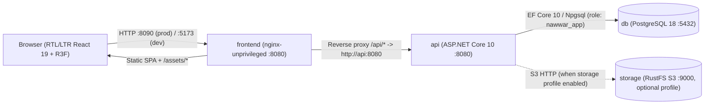
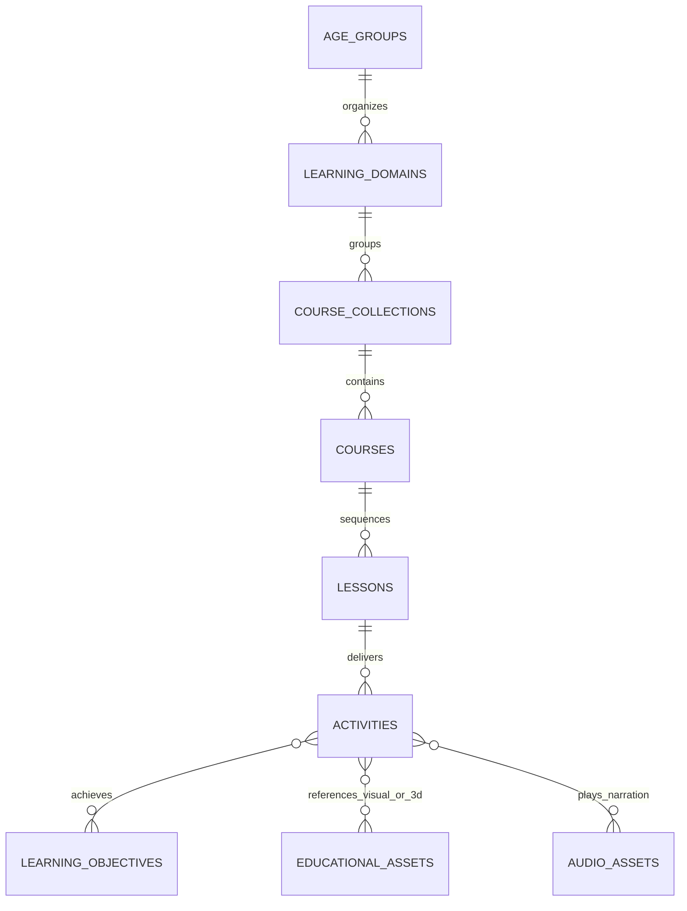

# ARCHITECTURE.md — NAWWAR Technical Architecture

> This document describes both the **currently running infrastructure/codebase** and the **realigned preschool educational architecture (`ADR-0009`, Phases A–I)** for **NAWWAR (نَوَّر)** — an Arabic-first, immersive 3D educational platform for children aged **3, 4, and 5 years**.

---

## 1. System Overview

NAWWAR is a containerized, Arabic-first 3D educational web application for preschool children (ages 3, 4, and 5) composed of three core services and one optional object-storage service:

---

## 2. Key Architecture Decisions

All architectural choices are recorded as ADRs in [`DECISIONS.md`](DECISIONS.md):
- **ADR-0001**: Docker-first development and validation across two isolated bridge networks (`frontend_net`, `backend_net`).
- **ADR-0002**: ASP.NET Core 10 Minimal API (`Nawwar.Api`) with EF Core 10 and PostgreSQL 18.
- **ADR-0003**: React 19 + TypeScript 7 + Vite 8 + React Three Fiber (`@react-three/fiber`) with lazy-loaded 3D canvas chunking.
- **ADR-0004**: Arabic (`ar`, `rtl`) as the default culture on both frontend and backend, backed by CSS logical properties and compile-time translation key parity (`satisfies typeof ar`).
- **ADR-0005**: Same-origin `/api` reverse proxy (nginx in production, Vite dev server in development) eliminating cross-origin credential and CORS fragility.
- **ADR-0006**: Least-privilege PostgreSQL role (`nawwar_app`) created automatically on first volume initialization.
- **ADR-0007**: Optional S3-compatible object storage using `rustfs/rustfs:1.0.4` under a Compose profile (`storage`), replacing discontinued upstream MinIO Docker Hub images.
- **ADR-0008**: Mandatory binary glTF 2.0 (`.glb`) standard (`model/gltf-binary`) for 3D scene assets.
- **ADR-0009**: Product realignment to the preschool age-based curriculum (Ages 3, 4, 5 — *عَالَمُ الاِكْتِشَافِ*، *عَالَمُ الاِسْتِكْشَافِ*، *عَالَمُ التَّعَلُّمِ*), decoupling lessons/activities from single `.glb` files, and deferring authentication until `PHASE H`.

---

## 3. Frontend Architecture (`frontend/`)

- **Entry & bootstrapping** ([`src/main.tsx`](frontend/src/main.tsx)):
  - Loads self-hosted `@fontsource-variable/noto-sans-arabic` WOFF2 font subsets.
  - Initializes `src/i18n` before first render so `<html lang="..." dir="...">` matches the active language immediately.
- **Application shell** ([`src/App.tsx`](frontend/src/App.tsx)):
  - Renders the localized header (`LanguageSwitcher`), hero section, 3D scene card (`WorldCanvas` inside `ErrorBoundary` + `Suspense`), and backend status card (`ApiStatus`).
- **API client** ([`src/lib/api.ts`](frontend/src/lib/api.ts)):
  - Issues same-origin requests to `/api/v1/...` with an `Accept-Language` header matching `i18n.language`.

---

## 4. 3D Rendering Architecture (`frontend/src/features/world/`)

- **Code splitting**: [`WorldCanvas.tsx`](frontend/src/features/world/WorldCanvas.tsx) is loaded via `React.lazy` in `App.tsx`, keeping the `three` + `@react-three/fiber` + `@react-three/drei` bundle out of the initial critical path.
- **Binary `.glb` Pipeline** ([`WorldScene.tsx`](frontend/src/features/world/WorldScene.tsx)):
  - Enforces `.glb` format (`isValidGlbUrl(modelUrl)`) and loads binary glTF 2.0 models (`/models/lantern.glb`, `/models/solar-system.glb`, `/models/crystal-lattice.glb`) via `useGLTF` from `@react-three/drei`.
  - Clones the loaded scene graph so material highlight state stays isolated per instance, highlights the mesh matching the active checkpoint's `TargetNodeName`, supports direct 3D mesh picking (`onClick` → `onSelectNode`), disposes cloned materials on unmount, and renders a focus ring at the checkpoint's 3D `FocusPoint`.
  - Checks `window.matchMedia('(prefers-reduced-motion: reduce)')` and pauses frame rotation when reduced motion is requested.
- **Fault isolation**: [`ErrorBoundary.tsx`](frontend/src/components/ErrorBoundary.tsx) catches WebGL or asset errors and displays a localized fallback notice.

---

## 5. Educational Content Architecture (`Features/Curriculum` & `features/curriculum`)

### 5.1 Current Codebase State (Pre-Phase C Audit)
- The repository currently runs an initial prototype slice (`LearningModule` → `Lesson` → `LessonCheckpoint` + `CheckpointCompletion`) under `backend/src/Nawwar.Api/Features/Curriculum/` and `frontend/src/features/curriculum/CurriculumExplorer.tsx`.
- **Identified Divergence (Resolved by `ADR-0009`)**:
  1. The prototype seeded secondary-school scientific topics (optics, astronomy, crystal lattices) instead of the preschool (ages 3, 4, 5) curriculum.
  2. Every `Lesson` row was tightly coupled to a single `.glb` file (`model_url`) and 3D node checkpoints, whereas preschool lessons require multi-modal activities (3D exploration, audio listening, visual matching/sorting, counting, letter forms, short vowels *الفتحة/الكسرة/الضمة*, and syllable/word/sentence reading).

### 5.2 Target Realigned Curriculum & Activity Architecture (`PHASE C` – `PHASE G`)

Per [`docs/product/AGE_BASED_CURRICULUM.md`](docs/product/AGE_BASED_CURRICULUM.md) and `ADR-0009`, educational content is separated from presentation and 3D scene implementation across a 7-level hierarchy:

- **Core Curriculum Entities (`PHASE C`)**:
  - `AgeGroup`: `3` (*عَالَمُ الاِكْتِشَافِ — 3 سَنَوَاتٍ*), `4` (*عَالَمُ الاِسْتِكْشَافِ — 4 سَنَوَاتٍ*), `5` (*عَالَمُ التَّعَلُّمِ — 5 سَنَوَاتٍ*).
  - `LearningDomain`: Domain within an age group (e.g., *اللُّغَةُ العَرَبِيَّةُ*، *الأَلْوَانُ وَالأَشْكَالُ*، *الأَعْدَادُ وَالحِسَابُ*، *الحَيَوَانَاتُ وَالطَّبِيعَةُ*، *المَنْطِقُ*).
  - `CourseCollection`: Ordered pathway within a domain (e.g., **`مَسَارُ تَعَلُّمِ القِرَاءَةِ`** for Age 5 Arabic reading).
  - `Course`: Structured course with `TitleAr`, `DescriptionAr`, `TargetAge`, `DisplayOrder`, `DifficultyLevel`, `CompletionCriteria`, and linked `LearningObjectives`.
  - `Lesson`: Pedagogical lesson unit within a course (decoupled from any single `.glb` file).
  - `Activity`: Multi-modal interactive step (`scene_3d_explore`, `audio_listen_pick`, `visual_match_sort`, `counting_interactive`, `letter_forms_vowels`, `syllable_word_builder`) with a JSON configuration payload and references to `EducationalAssets` (`.glb` scenes, 2D illustrations, animations) and `AudioAssets`.
  - `LearningObjective`: Measurable early-childhood learning outcome.
  - `ContentTranslation`: Localization table (`ar` primary, `fr`, `en`) for translatable text and audio references.
  - `ProgressDefinition` & `ActivityCompletion`: Tracks completion across activities, lessons, and courses without requiring authentication in early phases (`PHASE G`), ready to bind to learner profiles in `PHASE H`.

---

## 6. Localization Architecture

- **Frontend** ([`frontend/src/i18n/`](frontend/src/i18n/index.ts)):
  - Supported languages: `ar` (default, `rtl`), `fr` (`ltr`), `en` (`ltr`).
  - `resources.ts` enforces compile-time key completeness of `fr.json` and `en.json` against `ar.json` using TypeScript's `satisfies typeof ar`.
  - Language changes update `document.documentElement.lang`, `document.documentElement.dir`, and `localStorage['nawwar.language']`.
  - Layout styles in [`frontend/src/index.css`](frontend/src/index.css) exclusively use CSS logical properties (`margin-inline`, `padding-inline`, `border-inline-start`, `text-align: start`).
- **Backend** ([`LocalizationSetup.cs`](backend/src/Nawwar.Api/Infrastructure/Localization/LocalizationSetup.cs)):
  - Configures ASP.NET Core `RequestLocalizationMiddleware` with default culture `ar` and supported cultures `["ar", "fr", "en"]`.
  - Sets `ApplyCurrentCultureToResponseHeaders = true` so every response includes `Content-Language`.

---

## 7. Backend Architecture (`backend/`)

- **Solution**: [`backend/Nawwar.slnx`](backend/Nawwar.slnx) containing `src/Nawwar.Api` and `tests/Nawwar.Api.Tests`.
- **Pipeline** ([`Program.cs`](backend/src/Nawwar.Api/Program.cs)):
  1. `UseForwardedHeaders()` — honors `X-Forwarded-For` and `X-Forwarded-Proto` from the nginx reverse proxy.
  2. `UseExceptionHandler()` & `UseStatusCodePages()` — emits RFC 9457 `application/problem+json` error payloads.
  3. `UseRequestLocalization()` — resolves `ar` (default), `fr`, or `en`.
  4. `MapOpenApi()` — exposes `/openapi/v1.json` in `Development`.
  5. Health endpoints (`/health/live`, `/health/ready`) and versioned API group (`/api/v1`).

---

## 8. Database Model and Persistence (`NawwarDbContext`)

- **Engine**: PostgreSQL 18 (`postgres:18-alpine`) with persistent data stored in the `postgres_data` volume at `/var/lib/postgresql`.
- **Context**: [`NawwarDbContext.cs`](backend/src/Nawwar.Api/Infrastructure/Persistence/NawwarDbContext.cs) registered with Npgsql (`EnableRetryOnFailure()`) in [`PersistenceSetup.cs`](backend/src/Nawwar.Api/Infrastructure/Persistence/PersistenceSetup.cs).
- **Provisioning**: On first initialization of an empty volume, [`infra/postgres/init/10-create-app-role.sh`](infra/postgres/init/10-create-app-role.sh) creates the non-superuser role `NAWWAR_DB_USER` (`nawwar_app`), transfers ownership of database `POSTGRES_DB` (`nawwar`) to it, and revokes `PUBLIC` connect privileges.
- **Schema & Seeding**: [`CurriculumInitializer.cs`](backend/src/Nawwar.Api/Infrastructure/Persistence/CurriculumInitializer.cs) ensures the `learning_modules`, `lessons`, and `lesson_checkpoints` tables exist on startup and seeds the initial 3 Arabic/French/English modules and `.glb` lessons (see [`docs/architecture/DATABASE_SCHEMA.md`](docs/architecture/DATABASE_SCHEMA.md)).

---

## 9. API Structure

| Method & Path | Purpose | Auth | Response |
|---|---|---|---|
| `GET /health/live` | Process liveness probe (no DB check) | Public | `200 OK` (`Healthy`) |
| `GET /health/ready` | Readiness probe (verifies PostgreSQL connectivity via `NawwarDbContext`) | Internal / Probe | `200 OK` (`Healthy`) or `503 Service Unavailable` |
| `GET /api/v1/system/info` | Service metadata and resolved request culture/direction | Public | `200 OK` JSON (`SystemInfoResponse`) + `Content-Language` header |
| `GET /api/v1/curriculum/modules` | Localized list of learning modules and `.glb` lesson summaries | Public | `200 OK` JSON (`CurriculumOverviewResponse`) |
| `GET /api/v1/curriculum/lessons/{slug}` | Localized `.glb` lesson detail, camera config, and 3D scene checkpoints | Public | `200 OK` JSON (`LessonDetailResponse`) or `404` Problem Details |
| `GET /api/v1/curriculum/progress` | Completed 3D scene checkpoints across all lessons for a learner | Public | `200 OK` JSON (`LearnerProgressResponse`) |
| `POST /api/v1/curriculum/lessons/{slug}/checkpoints/{stepOrder}/complete` | Idempotently marks a 3D checkpoint as completed for a learner | Public | `200 OK` JSON (`LearnerProgressResponse`) or `400`/`404` Problem Details |
| `GET /openapi/v1.json` | OpenAPI 3 document (`Development` environment only) | Dev only | `200 OK` JSON |

---

## 10. Authentication, Authorization & Asset Management

- **Authentication & Authorization**: Not yet implemented in Phase 1. Planned for Phase 2 using ASP.NET Core authentication and role/claim policies.
- **Asset Management**:
  - Static UI fonts and icons are bundled by Vite and served with `Cache-Control: public, max-age=31536000, immutable` from `/assets/`.
  - Optional S3-compatible object storage (`rustfs/rustfs:1.0.4`) is pre-configured on `backend_net` (`http://storage:9000`) under the `storage` Compose profile for Phase 3 3D assets and audio.

---

## 11. Docker & Deployment Architecture

| Service | Image / Target | Internal Port | Default Host Port | User | Networks |
|---|---|---|---|---|---|
| `db` | `postgres:18-alpine` | `5432` | None (`127.0.0.1:54329` in dev) | `postgres` (UID 70) | `backend_net` |
| `api` | `nawwar/api:latest` (`runtime`) | `8080` | None (`127.0.0.1:5080` in dev) | `app` (UID 1654) | `backend_net`, `frontend_net` |
| `frontend` | `nawwar/frontend:latest` (`runtime`) | `8080` (`5173` in dev) | `${NAWWAR_WEB_PORT:-8090}` (`5173` in dev) | `nginx` (UID 101) / `node` (UID 1000) | `frontend_net` |
| `storage` | `rustfs/rustfs:1.0.4` (`--profile storage`) | `9000`, `9001` | `127.0.0.1:9000`, `127.0.0.1:9001` | `rustfs` (UID 10001) | `backend_net` |

- **Network isolation**: `db` and `storage` reside exclusively on `backend_net`; `frontend` resides only on `frontend_net`; `api` bridges the two. In `docker-compose.prod.yml`, `backend_net` is marked `internal: true` and `api`/`frontend` run with `read_only: true`, `cap_drop: [ALL]`, and `no-new-privileges:true`.

