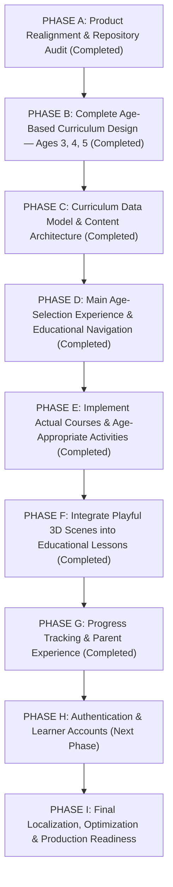

# ROADMAP.md — NAWWAR (نَوَّر) Preschool Product & Engineering Roadmap

This document defines the mandatory, sequential execution roadmap (`PHASE A` through `PHASE I`) for **NAWWAR (نَوَّر)** — an Arabic-first, immersive 3D educational platform for preschool children aged **3, 4, and 5 years**.

> **Execution Rule**: Do not jump to a later phase while an earlier phase remains incomplete. Authentication and learner accounts (`PHASE H`) come only after the complete age-based curriculum, navigation, multi-modal activities, 3D learning scenes, and progress foundations are in place.

---

## Mandatory Execution Sequence (`PHASE A` → `PHASE I`)

---

## Foundational Infrastructure Baseline (Completed Prior to Realignment)

- [x] Reproducible Docker Compose stack (`db` PostgreSQL 18, `api` ASP.NET Core 10, `frontend` React 19 + Vite 8 + nginx, optional `storage` RustFS S3 profile).
- [x] Arabic-first (`ar` / `rtl`) localization foundation (`i18next`, compile-time key parity, CSS logical properties, `Noto Sans Arabic Variable`).
- [x] Reusable React Three Fiber (`WorldCanvas`, `WorldScene`) `.glb` loader, object picking, material disposal, `ErrorBoundary`, and `prefers-reduced-motion` support.

---

## PHASE A — Product Realignment & Repository Audit

- **Status**: **Completed (2026-11-03)**
- **Objectives**:
  - Audit existing backend, frontend, 3D assets, and documentation.
  - Identify product divergence (scientific optics/astronomy/crystal prototype vs. preschool ages 3–5 vision; tight `.glb` coupling on `Lesson`).
  - Realign `AGENTS.md`, `ARCHITECTURE.md`, `PROGRESS.md`, `ROADMAP.md`, and `DECISIONS.md` (`ADR-0009`).

---

## PHASE B — Complete Age-Based Curriculum Design (Ages 3, 4, 5)

- **Status**: **Completed (2026-11-03)**
- **Deliverables**:
  - [`docs/product/AGE_BASED_CURRICULUM.md`](docs/product/AGE_BASED_CURRICULUM.md):
    1. Educational philosophy of NAWWAR.
    2. The three age worlds (*عَالَمُ الاِكْتِشَافِ — 3 سَنَوَاتٍ*، *عَالَمُ الاِسْتِكْشَافِ — 4 سَنَوَاتٍ*، *عَالَمُ التَّعَلُّمِ — 5 سَنَوَاتٍ*).
    3. Learning objectives for Ages 3, 4, and 5.
    4. Learning domains for each age.
    5. Course collections for every domain (including the dedicated Age 5 reading pathway `مَسَارُ تَعَلُّمِ القِرَاءَةِ`).
    6. Course and lesson progression rules.
    7. Six reusable interactive activity types.
    8. Age-appropriate 3D interaction concepts.
    9. Arabic-first vowelization (tashkeel) and audio requirements.
    10. Future French (`fr`) and English (`en`) localization strategy.
  - [`docs/product/USER_FLOWS.md`](docs/product/USER_FLOWS.md), [`docs/product/PRODUCT_SPECIFICATION.md`](docs/product/PRODUCT_SPECIFICATION.md), and [`docs/product/EDUCATIONAL_FRAMEWORK.md`](docs/product/EDUCATIONAL_FRAMEWORK.md).

---

## PHASE C — Curriculum Data Model & Content Architecture

- **Status**: **Completed (2026-11-03)**
- **Deliverables**:
  - Implemented the decoupled 7-level preschool curriculum schema in PostgreSQL 18 (`NawwarDbContext` & `CurriculumConfigurations`):
    - `AgeGroup` (`age_groups`: `3`, `4`, `5` years with `ck_age_groups_age_years`)
    - `LearningDomain` (`learning_domains`)
    - `CourseCollection` (`course_collections`, including `is_reading_pathway` for `مَسَارُ تَعَلُّمِ القِرَاءَةِ`)
    - `Course` (`courses`)
    - `LearningObjective` (`learning_objectives`)
    - `Lesson` (`lessons` — decoupled from `.glb` files)
    - `Activity` (`activities` — multi-modal activity definitions with `ck_activities_glb_model_url`)
    - `ActivityCompletion` (`activity_completions`)
  - Implemented REST endpoints under `/api/v1/curriculum/age-groups`, `/api/v1/curriculum/age-groups/{ageYears:int}`, `/api/v1/curriculum/lessons/{slug}`, `/api/v1/curriculum/progress`, and `POST /api/v1/curriculum/activities/{activitySlug}/complete`.

---

## PHASE D — Main Age-Selection Experience & Educational Navigation

- **Status**: **Completed (2026-11-03)**
- **Deliverables**:
  - Implemented [`AgeWorldSelector.tsx`](frontend/src/features/age-selector/AgeWorldSelector.tsx) around the three preschool age-group portals:
    - **عَالَمُ الاِكْتِشَافِ — 3 سَنَوَاتٍ**
    - **عَالَمُ الاِسْتِكْشَافِ — 4 سَنَوَاتٍ**
    - **عَالَمُ التَّعَلُّمِ — 5 سَنَوَاتٍ**
  - Built child- and parent-friendly RTL/LTR navigation through **Learning Domains (`DomainGrid.tsx`) → Course Collections & Courses (`CoursePathwayView.tsx`) → Lessons & Activities (`LessonStageView.tsx`)** in [`CurriculumWorkspace.tsx`](frontend/src/features/curriculum/CurriculumWorkspace.tsx).

---

## PHASE E — Implement Actual Courses & Age-Appropriate Activities

- **Status**: **Completed (2026-11-03)**
- **Deliverables**:
  - Implemented the multi-modal activity engine (`ActivityRenderer.tsx`, `InteractiveChoiceActivity.tsx`, `Scene3DExploreActivity.tsx`, `AudioPromptButton.tsx`) supporting:
    - `scene_3d_explore` (3D exploration + object tap)
    - `audio_listen_pick` (spoken Arabic prompt + visual option cards)
    - `visual_match_sort` (visual association, animal habitats, logical sequences)
    - `counting_interactive` (counting 1–3, 1–10, and simple addition stories)
    - `letter_forms_vowels` (Arabic positional letter forms `بـ / ـبـ / ـب` and short vowels *الفَتْحَةُ، الكَسْرَةُ، الضَّمَّةُ*)
    - `syllable_word_builder` (syllable blending `كَـ + تَـ + بَ = كَتَبَ`, word reading, and short vocalized sentences)
  - Seeded authentic, fully vowelized Arabic courses across Ages 3, 4, and 5 (including all 6 courses of `مَسَارُ تَعَلُّمِ القِرَاءَةِ`) in `CurriculumCatalog.cs`.

---

## PHASE F — Integrate Playful 3D Scenes into Educational Lessons

- **Status**: **Completed (2026-11-03)**
- **Deliverables**:
  - Generated spec-compliant binary glTF 2.0 (`.glb`) preschool models (`garden-colors.glb`, `friendly-farm.glb`, `counting-blocks.glb`, `arabic-letters-stage.glb`) via `frontend/scripts/generate-glb-models.mjs` and integrated them into `scene_3d_explore` activities via `Scene3DExploreActivity.tsx`, `WorldCanvas.tsx`, and `WorldScene.tsx`.

---

## PHASE G — Progress Tracking & Parent Experience

- **Status**: **Completed (2026-11-03)**
- **Deliverables**:
  - Implemented `ActivityCompletion` persistence in PostgreSQL 18 (`GET /api/v1/curriculum/progress`, `POST /api/v1/curriculum/activities/{activitySlug}/complete`) with per-age breakdowns (`byAge` for Ages 3, 4, and 5) and [`ParentProgressPanel.tsx`](frontend/src/features/progress/ParentProgressPanel.tsx).

---

## PHASE H — Authentication & Learner Accounts

- **Status**: Planned (Next Phase)
- **Dependencies**: PHASE G
- **Objectives**:
  - Add parent accounts and multiple child learner profiles (with age selection) that attach seamlessly to the `PHASE G` progress system (`learnerKey`).

---

## PHASE I — Final Localization, Optimization & Production Readiness

- **Status**: Planned (Final phase)
- **Dependencies**: PHASE H
- **Objectives**:
  - Expand audio recordings, Playwright E2E suite, performance tuning, and production security audit.
