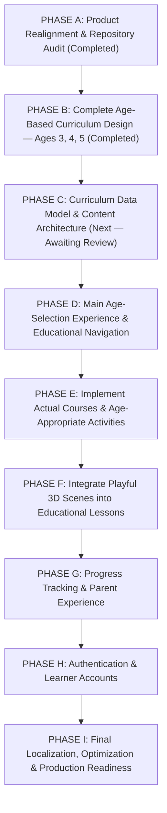

# ROADMAP.md — NAWWAR (نَوَّر) Preschool Product & Engineering Roadmap

This document defines the mandatory, sequential execution roadmap (`PHASE A` through `PHASE I`) for **NAWWAR (نَوَّر)** — an Arabic-first, immersive 3D educational platform for preschool children aged **3, 4, and 5 years**.

> **Execution Rule**: Do not jump to a later phase while an earlier phase remains incomplete. Authentication and learner accounts (`PHASE H`) come only after the complete age-based curriculum, navigation, multi-modal activities, 3D learning scenes, and progress foundations are in place.

---

## Mandatory Execution Sequence (`PHASE A` → `PHASE I`)

---

## Foundational Infrastructure Baseline (Completed Prior to Realignment)

- [x] Reproducible Docker Compose stack (`db` PostgreSQL 18, `api` ASP.NET Core 10, `frontend` React 19 + Vite 8 + nginx, optional `storage` RustFS S3 profile).
- [x] Arabic-first (`ar` / `rtl`) localization foundation (`i18next`, compile-time key parity, CSS logical properties, `Noto Sans Arabic Variable`).
- [x] Reusable React Three Fiber (`WorldCanvas`, `WorldScene`) `.glb` loader, object picking, material disposal, `ErrorBoundary`, and `prefers-reduced-motion` support.

---

## PHASE A — Product Realignment & Repository Audit

- **Status**: **Completed (2026-11-03)**
- **Objectives**:
  - Audit existing backend, frontend, 3D assets, and documentation.
  - Identify product divergence (scientific optics/astronomy/crystal prototype vs. preschool ages 3–5 vision; tight `.glb` coupling on `Lesson`).
  - Realign `AGENTS.md`, `ARCHITECTURE.md`, `PROGRESS.md`, `ROADMAP.md`, and `DECISIONS.md` (`ADR-0009`).

---

## PHASE B — Complete Age-Based Curriculum Design (Ages 3, 4, 5)

- **Status**: **Completed (2026-11-03)**
- **Deliverables**:
  - [`docs/product/AGE_BASED_CURRICULUM.md`](docs/product/AGE_BASED_CURRICULUM.md):
    1. Educational philosophy of NAWWAR.
    2. The three age worlds (*عَالَمُ الاِكْتِشَافِ — 3 سَنَوَاتٍ*، *عَالَمُ الاِسْتِكْشَافِ — 4 سَنَوَاتٍ*، *عَالَمُ التَّعَلُّمِ — 5 سَنَوَاتٍ*).
    3. Learning objectives for Ages 3, 4, and 5.
    4. Learning domains for each age.
    5. Course collections for every domain (including the dedicated Age 5 reading pathway `مَسَارُ تَعَلُّمِ القِرَاءَةِ`).
    6. Course and lesson progression rules.
    7. Six reusable interactive activity types.
    8. Age-appropriate 3D interaction concepts.
    9. Arabic-first vowelization (tashkeel) and audio requirements.
    10. Future French (`fr`) and English (`en`) localization strategy.
  - [`docs/product/USER_FLOWS.md`](docs/product/USER_FLOWS.md), [`docs/product/PRODUCT_SPECIFICATION.md`](docs/product/PRODUCT_SPECIFICATION.md), and [`docs/product/EDUCATIONAL_FRAMEWORK.md`](docs/product/EDUCATIONAL_FRAMEWORK.md).

---

## PHASE C — Curriculum Data Model & Content Architecture

- **Status**: **Proposed — Ready for Implementation Upon Approval**
- **Dependencies**: PHASE A, PHASE B
- **Objectives**:
  - Replace the flat prototype module/checkpoint schema with the decoupled 7-level preschool curriculum schema in PostgreSQL 18 (`NawwarDbContext`):
    - `AgeGroups` (`age_groups`: 3, 4, 5 years)
    - `LearningDomains` (`learning_domains`)
    - `CourseCollections` (`course_collections`, e.g., `مَسَارُ تَعَلُّمِ القِرَاءَةِ`)
    - `Courses` (`courses`)
    - `Lessons` (`lessons` — decoupled from any single `.glb` file)
    - `Activities` (`activities` — multi-modal activity definitions)
    - `LearningObjectives` (`learning_objectives`)
    - `EducationalAssets` & `AudioAssets` (`educational_assets`, `audio_assets`)
    - `Translations` (`content_translations`)
    - `ProgressDefinitions` & activity completion records
  - Expose REST endpoints under `/api/v1/curriculum/age-groups`, `/api/v1/curriculum/age-groups/{age}/domains`, `/api/v1/curriculum/courses/{slug}`, and `/api/v1/curriculum/lessons/{slug}`.

---

## PHASE D — Main Age-Selection Experience & Educational Navigation

- **Status**: Planned (After PHASE C)
- **Dependencies**: PHASE C
- **Objectives**:
  - Redesign the main entry screen around the three preschool age-group portals:
    - **عَالَمُ الاِكْتِشَافِ — 3 سَنَوَاتٍ**
    - **عَالَمُ الاِسْتِكْشَافِ — 4 سَنَوَاتٍ**
    - **عَالَمُ التَّعَلُّمِ — 5 سَنَوَاتٍ**
  - Build child- and parent-friendly RTL/LTR navigation through **Learning Domains → Course Collections → Courses → Lessons → Activities**.

---

## PHASE E — Implement Actual Courses & Age-Appropriate Activities

- **Status**: Planned (After PHASE D)
- **Dependencies**: PHASE D
- **Objectives**:
  - Implement the multi-modal activity engine supporting audio listening/picking, visual matching/sorting, interactive counting (1–3, 1–10, 1–20 + simple addition), Arabic letter discovery, positional letter forms, short vowels (*الفتحة، الكسرة، الضمة*), syllable construction, word reading, and short vocalized sentence reading.
  - Seed authentic, fully vowelized Arabic courses across Ages 3, 4, and 5 (including all 6 courses of `مَسَارُ تَعَلُّمِ القِرَاءَةِ`).

---

## PHASE F — Integrate Playful 3D Scenes into Educational Lessons

- **Status**: Planned (After PHASE E)
- **Dependencies**: PHASE E
- **Objectives**:
  - Create and integrate age-appropriate `.glb` 3D scenes (3D Color & Shape Garden, Friendly Farm Animals, 3D Counting Toys, 3D Arabic Letters & Syllables) into `scene_3d_explore` activities using `WorldCanvas` / `WorldScene`.

---

## PHASE G — Progress Tracking & Parent Experience

- **Status**: Planned (After PHASE F)
- **Dependencies**: PHASE F
- **Objectives**:
  - Track completed activities, lessons, courses, and mastered learning objectives per age group, with a clear parent overview screen.

---

## PHASE H — Authentication & Learner Accounts

- **Status**: Planned (Deferred until PHASE G is complete)
- **Dependencies**: PHASE G
- **Objectives**:
  - Add parent accounts and multiple child learner profiles (with age selection) that attach seamlessly to the `PHASE G` progress system.

---

## PHASE I — Final Localization, Optimization & Production Readiness

- **Status**: Planned (Final phase)
- **Dependencies**: PHASE H
- **Objectives**:
  - Complete French (`fr`) and English (`en`) content/audio coverage per the localization strategy in `AGE_BASED_CURRICULUM.md`, Playwright E2E suite, performance tuning, and production security audit.
