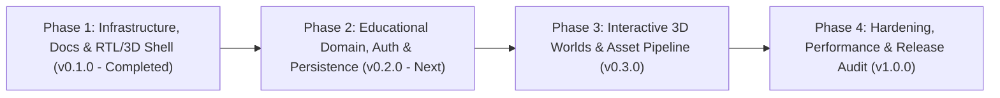

# ROADMAP.md — NAWWAR Development Roadmap

This document defines the phased engineering roadmap, milestones, dependencies, and acceptance criteria for **NAWWAR (نوّار)**.

---

## Overview of Phases

---

## Phase 1 — Docker-First Infrastructure, Documentation & Foundational Shell (`v0.1.0`)

- **Priority**: P0 (Blocker for all subsequent work)
- **Status**: **Completed & Validated**
- **Objectives**:
  - Establish reproducible multi-stage Dockerfiles and Docker Compose configurations (`docker-compose.yml`, `docker-compose.dev.yml`, `docker-compose.prod.yml`).
  - Bootstrap the ASP.NET Core 10 Minimal API (`Nawwar.Api`) with PostgreSQL 18 connectivity, health checks, and Arabic-first localization (`ar`, `fr`, `en`).
  - Bootstrap the React 19 + TypeScript 7 + Vite 8 + React Three Fiber frontend shell with RTL-first CSS logical layout, compile-time translation parity, lazy-loaded 3D viewport, and live API status check.
  - Establish mandatory project documentation (`AGENTS.md`, `ARCHITECTURE.md`, `PROGRESS.md`, `ROADMAP.md`, `DECISIONS.md`, `CHANGELOG.md`, `README.md`, and `docs/`).
- **Acceptance Criteria**:
  - [x] `docker compose up --build -d` builds and starts `db`, `api`, and `frontend` with all three reaching `healthy`.
  - [x] Database state persists across `docker compose down` and `docker compose up -d`.
  - [x] Frontend unit tests (`vitest`), typecheck (`tsc -b`), and linter (`oxlint --deny-warnings`) pass with zero warnings/errors.
  - [x] Backend build (`TreatWarningsAsErrors=true`) and integration tests (`xunit.v3`) pass.
  - [x] Arabic (`ar`, `rtl`) renders by default and switches cleanly to French (`fr`, `ltr`) and English (`en`, `ltr`).

---

## Phase 2 — Educational Domain Model, Persistence & Authentication (`v0.2.0`)

- **Priority**: P1
- **Status**: Planned (Not started)
- **Dependencies**: Phase 1
- **Objectives**:
  - Design and implement the core PostgreSQL schema and EF Core 10 migrations for:
    - Localized learning modules, lessons, and interactive checkpoints (`ar`, `fr`, `en`).
    - Learner profiles, authentication/authorization, and lesson progress tracking.
  - Expose versioned REST endpoints under `/api/v1/modules`, `/api/v1/lessons`, and `/api/v1/auth` with Problem Details validation and integration tests against PostgreSQL.
  - Create product specification and schema docs (`docs/product/PRODUCT_SPECIFICATION.md`, `docs/architecture/DATABASE_SCHEMA.md`, `docs/architecture/API_DESIGN.md`).
- **Acceptance Criteria**:
  - [ ] EF Core migrations apply cleanly using the `nawwar_app` role on startup or via migration runner.
  - [ ] Localized curriculum endpoints return Arabic content by default with full diacritics preserved.
  - [ ] Authentication and authorization integration tests pass.

---

## Phase 3 — Interactive 3D Educational Worlds & Asset Pipeline (`v0.3.0`)

- **Priority**: P1
- **Status**: Planned (Not started)
- **Dependencies**: Phase 2 + `storage` Compose profile
- **Objectives**:
  - Integrate the S3-compatible `storage` service (`rustfs`) with the backend asset service for glTF/GLB models, compressed textures, and Arabic/French/English voiceover audio.
  - Build interactive React Three Fiber learning scenes with camera waypoints, object picking, localized 3D annotations, and keyboard/screen-reader accessibility alternatives.
  - Document the 3D asset budget and design system (`docs/design/DESIGN_SYSTEM.md`).
- **Acceptance Criteria**:
  - [ ] 3D lesson scenes load glTF/GLB assets from object storage with progress indicators and memory cleanup on unmount.
  - [ ] 60 FPS target on mid-range hardware; graceful degradation when WebGL or reduced-motion is active.
  - [ ] Independent review completed for visual quality, memory disposal, and RTL overlay alignment.

---

## Phase 4 — Performance, Security Audit & Release Readiness (`v1.0.0`)

- **Priority**: P2
- **Status**: Planned (Not started)
- **Dependencies**: Phase 3
- **Objectives**:
  - End-to-end Playwright browser test suite covering RTL/LTR flows, lesson progression, and 3D canvas interactions.
  - Production security and performance audit (`docker-compose.prod.yml`, CSP headers, rate limiting, bundle budgets).
  - Deployment guide (`docs/infrastructure/DEPLOYMENT.md`).
- **Acceptance Criteria**:
  - [ ] Full automated E2E suite passes against the production Docker Compose stack.
  - [ ] Independent security and localization review sign-off.

