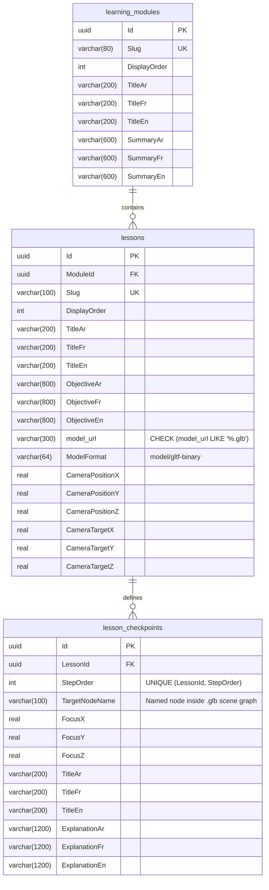

# Database Schema (`docs/architecture/DATABASE_SCHEMA.md`)

This document describes the PostgreSQL 18 relational schema managed by `NawwarDbContext` ([`NawwarDbContext.cs`](../../backend/src/Nawwar.Api/Infrastructure/Persistence/NawwarDbContext.cs)).

---

## 1. Entity-Relationship Diagram

---

## 2. `.glb` 3D Asset Constraint

Every row in `lessons` must reference a binary glTF 2.0 (`.glb`) 3D model:
- Enforced at the PostgreSQL level by check constraint `ck_lessons_model_url_glb` (`model_url LIKE '%.glb'`) in [`CurriculumConfigurations.cs`](../../backend/src/Nawwar.Api/Infrastructure/Persistence/Configurations/CurriculumConfigurations.cs).
- Enforced in domain logic by `Lesson.IsValidGlbUrl(url)` in [`Lesson.cs`](../../backend/src/Nawwar.Api/Features/Curriculum/Domain/Lesson.cs) and in the frontend by `isValidGlbUrl(url)` in [`api.ts`](../../frontend/src/lib/api.ts).
