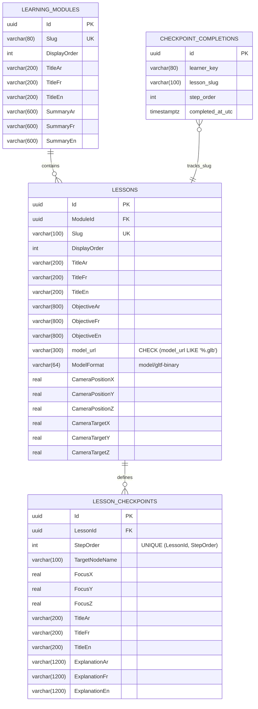

# Database Schema — NAWWAR (`PostgreSQL 18`)

## 1. Entity-Relationship Overview

## 2. Constraints & Invariants

- **`ck_lessons_model_url_glb`**: Enforces at the PostgreSQL table level that `lessons.model_url` always ends with `.glb` (`model_url LIKE '%.glb'`).
- **Unique Indexes**:
  - `learning_modules ("Slug")`
  - `lessons ("Slug")`
  - `lesson_checkpoints ("LessonId", "StepOrder")`
  - `checkpoint_completions (learner_key, lesson_slug, step_order)` (`ix_checkpoint_completions_learner_lesson_step`)
- **Least-Privilege Access**:
  - Application traffic connects via `NAWWAR_DB_USER` (`nawwar_app`), provisioned on first container startup by `infra/postgres/init/10-create-app-role.sh`.
