# Database Schema — NAWWAR (`PostgreSQL 18`)

## 1. Entity-Relationship Overview (`PHASE C` 7-Level Preschool Curriculum)

```mermaid
erDiagram
    AGE_GROUPS ||--o{ LEARNING_DOMAINS : contains
    LEARNING_DOMAINS ||--o{ COURSE_COLLECTIONS : groups
    COURSE_COLLECTIONS ||--o{ COURSES : orders
    COURSES ||--o{ LEARNING_OBJECTIVES : defines
    COURSES ||--o{ LESSONS : contains
    LESSONS ||--o{ ACTIVITIES : stages
    ACTIVITY_COMPLETIONS }o--|| ACTIVITIES : tracks_slug

    AGE_GROUPS {
        uuid id PK
        int age_years UK "CHECK (age_years IN (3, 4, 5))"
        varchar(80) slug UK
        int display_order
        varchar(64) theme_key
        varchar(32) icon_emoji
        varchar(200) title_ar
        varchar(200) title_fr
        varchar(200) title_en
        varchar(300) subtitle_ar
        varchar(300) subtitle_fr
        varchar(300) subtitle_en
        varchar(800) description_ar
        varchar(800) description_fr
        varchar(800) description_en
    }

    LEARNING_DOMAINS {
        uuid id PK
        uuid age_group_id FK
        varchar(80) slug UK
        int display_order
        varchar(32) icon_emoji
        varchar(32) accent_color
        varchar(200) title_ar
        varchar(200) title_fr
        varchar(200) title_en
        varchar(600) summary_ar
        varchar(600) summary_fr
        varchar(600) summary_en
    }

    COURSE_COLLECTIONS {
        uuid id PK
        uuid learning_domain_id FK
        varchar(80) slug UK
        int display_order
        boolean is_reading_pathway
        varchar(200) title_ar
        varchar(200) title_fr
        varchar(200) title_en
        varchar(600) summary_ar
        varchar(600) summary_fr
        varchar(600) summary_en
    }

    COURSES {
        uuid id PK
        uuid course_collection_id FK
        varchar(80) slug UK
        int display_order
        varchar(32) icon_emoji
        varchar(200) title_ar
        varchar(200) title_fr
        varchar(200) title_en
        varchar(600) summary_ar
        varchar(600) summary_fr
        varchar(600) summary_en
    }

    LEARNING_OBJECTIVES {
        uuid id PK
        uuid course_id FK
        varchar(64) code UK
        int display_order
        varchar(400) title_ar
        varchar(400) title_fr
        varchar(400) title_en
    }

    LESSONS {
        uuid id PK
        uuid course_id FK
        varchar(100) slug UK
        int display_order
        int estimated_minutes
        varchar(200) title_ar
        varchar(200) title_fr
        varchar(200) title_en
        varchar(600) summary_ar
        varchar(600) summary_fr
        varchar(600) summary_en
    }

    ACTIVITIES {
        uuid id PK
        uuid lesson_id FK
        varchar(100) slug UK
        int step_order "UNIQUE (lesson_id, step_order)"
        varchar(48) activity_type "scene_3d_explore | audio_listen_pick | visual_match_sort | counting_interactive | letter_forms_vowels | syllable_word_builder"
        varchar(64) objective_code
        varchar(300) glb_model_url "NULL or CHECK (glb_model_url LIKE '%.glb')"
        varchar(100) target_node_name
        real focus_x
        real focus_y
        real focus_z
        varchar(200) title_ar
        varchar(200) title_fr
        varchar(200) title_en
        varchar(800) prompt_ar
        varchar(800) prompt_fr
        varchar(800) prompt_en
        varchar(600) spoken_text_ar
        varchar(600) spoken_text_fr
        varchar(600) spoken_text_en
        text interaction_payload_json
    }

    ACTIVITY_COMPLETIONS {
        uuid id PK
        varchar(80) learner_key
        varchar(100) activity_slug
        int age_years
        timestamptz completed_at_utc
    }
```

## 2. Constraints & Invariants

- **`ck_age_groups_age_years`**: Enforces at the PostgreSQL table level that `age_groups.age_years` is one of the three preschool age worlds (`age_years IN (3, 4, 5)`).
- **`ck_activities_glb_model_url`**: Enforces that `activities.glb_model_url` is either `NULL` (for non-3D activities) or ends with `.glb` (`glb_model_url IS NULL OR glb_model_url LIKE '%.glb'`).
- **Unique Indexes**:
  - `age_groups ("age_years")` and `age_groups ("slug")`
  - `learning_domains ("slug")`
  - `course_collections ("slug")`
  - `courses ("slug")`
  - `learning_objectives ("code")`
  - `lessons ("slug")`
  - `activities ("slug")` and `activities ("lesson_id", "step_order")`
  - `activity_completions (learner_key, activity_slug)` (`ix_activity_completions_learner_activity`)
- **Least-Privilege Access**:
  - Application traffic connects via `NAWWAR_DB_USER` (`nawwar_app`), provisioned on first container startup by `infra/postgres/init/10-create-app-role.sh`.
