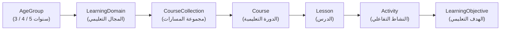

# Educational Framework — NAWWAR (نَوَّر)

## 1. Pedagogical Architecture

NAWWAR organizes early childhood learning (ages 3, 4, and 5) around a **data-driven 7-level curriculum hierarchy** where every interactive activity is explicitly linked to one or more measurable **Learning Objectives**:

For the full domain catalog, course collections, and reading pathway specification, see **[`AGE_BASED_CURRICULUM.md`](AGE_BASED_CURRICULUM.md)**.

---

## 2. Separation of Educational Content and Presentation

A core architectural rule of NAWWAR is that **educational content is separated from presentation and 3D scene implementation**:

1. **A `Lesson` is a pedagogical unit, not a `.glb` file wrapper**:
   - A lesson defines its learning objectives, target age, difficulty progression, and ordered **Activities**.
2. **An `Activity` selects the modality that best serves the child's learning objective**:
   - **3D Scene Exploration (`scene_3d_explore`)**: Uses a playful 3D environment (e.g., 3D color garden, friendly farm, 3D counting blocks, 3D Arabic letters) rendered via `WorldCanvas`.
   - **Audio Listening & Recognition (`audio_listen_pick`)**: Plays spoken Arabic or environmental/animal sounds and asks the child to pick the matching visual.
   - **Visual Sorting & Matching (`visual_match_sort`)**: Connects related items (letter to word illustration, animal to habitat, shape to pattern).
   - **Interactive Counting & Early Addition (`counting_interactive`)**: Counts concrete objects (1–3 for Age 3, 1–10 for Age 4, addition up to 10/20 for Age 5).
   - **Arabic Letter Forms & Short Vowels (`letter_forms_vowels`)**: Explores initial/medial/final letter shapes and *الفتحة، الكسرة، الضمة*.
   - **Syllable & Word/Sentence Reading (`syllable_word_builder`)**: Builds syllables into words and matches vocalized sentences to illustrations.
