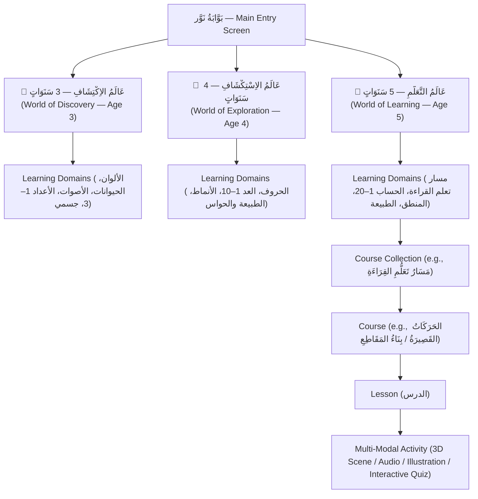

# USER_FLOWS.md — NAWWAR (نَوَّر) Preschool User Experience & Navigation Journey

## 1. Main Entry Point: Age-World Selection (بَوَّابَةُ اخْتِيَارِ العُمْرِ)

When a child or parent opens **NAWWAR (نَوَّر)**, the primary landing experience is **not** a login screen and **not** a scientific model inspector. Instead, it presents three large, joyful, audio-assisted age-world portals:

---

## 2. Visual Identity of Each Age World

| World | Arabic Title | Visual Theme & Accent Palette | Navigation Density |
|---|---|---|---|
| **Age 3** | **عَالَمُ الاِكْتِشَافِ — 3 سَنَوَاتٍ** | Sunny Meadow & Soft Sky (*المَرْجُ المُشْمِسُ*) — extra-large rounded cards, big speaker icons, minimal text. | 2–3 large cards per row; single tap enters activity. |
| **Age 4** | **عَالَمُ الاِسْتِكْشَافِ — 4 سَنَوَاتٍ** | Magical Garden & Alphabet Tree (*حَدِيقَةُ الحُرُوفِ وَالأَرْقَامِ*) — illustrated domain badges, clear letter/number emblems. | Domain tabs + course cards with star badges. |
| **Age 5** | **عَالَمُ التَّعَلُّمِ — 5 سَنَوَاتٍ** | Luminous Observatory of Knowledge (*وَاحَةُ المَعْرِفَةِ وَالقِرَاءَةِ*) — structured pathway map (especially for `مَسَارُ تَعَلُّمِ القِرَاءَةِ`), clear vowelized typography, step progression. | Structured course pathway with lesson & activity progress indicators. |

---

## 3. Step-by-Step User Journey Inside an Age World

1. **Step 1 — Select Age World (`AgeGroup`)**:
   - The user selects **3 سنوات**, **4 سنوات**, or **5 سنوات** (and can switch worlds at any time from the header bar).
2. **Step 2 — Browse Learning Domains (`LearningDomain`)**:
   - Displays the age group's learning domains as large, color-coded, audio-labeled cards (e.g., at Age 5: *اللُّغَةُ العَرَبِيَّةُ وَالقِرَاءَةُ*، *الرِّيَاضِيَّاتُ وَالحِسَابُ*، *المَنْطِقُ وَحَلُّ المُشْكِلَاتِ*، *الطَّبِيعَةُ وَالاِكْتِشَافُ*).
3. **Step 3 — Select Course Collection & Course (`CourseCollection` → `Course`)**:
   - Inside a domain, courses are grouped into clear collections (such as **`مَسَارُ تَعَلُّمِ القِرَاءَةِ`** containing the 6 sequential reading courses: *اِكْتِشَافُ الحُرُوفِ* → *أَشْكَالُ الحُرُوفِ* → *الحَرَكَاتُ القَصِيرَةُ* → *بِنَاءُ المَقَاطِعِ* → *قِرَاءَةُ الكَلِمَاتِ* → *قِرَاءَةُ الجُمَلِ البَسِيطَةِ*).
4. **Step 4 — Launch Lesson & Interactive Activity (`Lesson` → `Activity`)**:
   - Each lesson opens a clean, distraction-free learning stage where the active **Activity** renders using the appropriate modality:
     - **3D Exploration Stage** (`WorldCanvas`) when the activity uses a 3D scene (`scene_3d_explore`, 3D counting, 3D letters).
     - **2D Interactive Stage** when the activity focuses on vocalized reading cards, syllable building, audio listening, or drag-and-drop matching.
5. **Step 5 — Joyful Completion & Next Activity**:
   - Completing an activity awards a cheerful star/light badge, updates progress, and offers a single prominent button to continue to the next activity or lesson.
